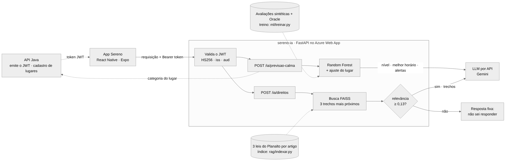

# Sereno — Serviço de IA (`sereno-ia`)

Global Solution 2026/2 · CitizenTech · FIAP — disciplina **Disruptive Architectures: IoT, IoB & Generative IA**

O Sereno é um app de acessibilidade urbana que avisa, antes de a pessoa sair de casa, se o destino e o caminho são acessíveis para ela. Este repositório é o serviço de IA do app: duas funções que aparecem dentro das telas do Sereno.

## Integrantes

| Nome | RM |
| --- | --- |
| Eduardo Augusto de Oliveira Souza | RM565269 |
| Fellipe Costa de Oliveira | RM564673 |
| Felype Ferreira Maschio | RM563009 |
| Gustavo Vieira de Matos | RM563304 |
| Pedro Henrique dos Santos Costa | RM562156 |

## O problema e quem se beneficia

Uma pessoa autista, com TDAH ou ansiedade pode desistir de ir à UBS ou ao mercado por medo de chegar num momento barulhento, iluminado demais ou lotado. Um cadeirante que encontra o elevador da estação parado muitas vezes não sabe o que a lei garante a ele. O serviço ataca as duas situações:

| Função | Onde aparece no app | Quem ajuda | Técnica |
| --- | --- | --- | --- |
| **Previsão de calma** — como o lugar deve estar num dia e hora, o horário mais tranquilo e uma frase simples explicando | Card na tela de detalhe do lugar | Pessoas com sensibilidade sensorial | Machine Learning (Random Forest) + IA generativa |
| **Quais são meus direitos?** — orientação baseada na lei, citando os artigos | Botão na tela da estação quando há equipamento parado | Pessoas com deficiência, mobilidade reduzida ou autismo | RAG básico (busca vetorial sobre 3 leis) + IA generativa |

Os requisitos pedem IA generativa mais um aprofundamento; aqui há dois (ML e RAG).

## Arquitetura



Fonte do diagrama: [`docs/arquitetura.mmd`](docs/arquitetura.mmd).

1. O usuário faz login na **API Java**, que emite um token JWT (HS256, `iss=sereno-auth`, `aud=sereno-app`). O serviço de IA só **valida** esse token com o mesmo `JWT_SECRET`; não existe login próprio.
2. **Previsão:** o serviço descobre a categoria do lugar (pela API Java ou, se ela não responder, pelo catálogo `ml/dados/locais.json`), o modelo prevê ruído, luz e lotação para todas as horas do dia e o LLM transforma o resultado numa frase simples.
3. **Direitos:** a pergunta vira um vetor, o índice FAISS devolve os 3 trechos de lei mais parecidos e, se forem relevantes o bastante, o LLM responde **só com base neles**, citando lei e artigo.
4. **Se o LLM falhar** (sem chave, fora do ar, tempo esgotado), o serviço continua respondendo com um texto montado por regra (`geradoPor: "regra"`). Se o serviço inteiro cair, o app esconde o card, como combinado no Contrato.

Os erros seguem o mesmo formato das APIs Java e .NET: `{ status, erro, mensagem, campos, timestamp, path }`.

### Tempo de resposta e consumo de tokens

Cada pergunta de direitos gasta cerca de 900 a 1.300 tokens (pergunta + 3 trechos + raciocínio do modelo), e o plano gratuito do Groq permite 8.000 tokens por minuto. Três medidas evitam que a pessoa fique esperando ou que o limite estoure:

| Medida | Como funciona | Configuração |
| --- | --- | --- |
| Cache | A mesma previsão (lugar, dia, hora) ou a mesma pergunta de direitos é reaproveitada por 1 hora, sem chamar o LLM. O botão de uma estação manda sempre o mesmo contexto, então só a primeira pessoa gasta tokens. Respostas alternativas (sem LLM) não entram no cache. | `CACHE_TTL` (segundos) |
| Raciocínio curto | Em modelos de raciocínio (gpt-oss, Gemini 2.5), pede menos "pensamento" antes da resposta: menos tokens e resposta mais rápida. | `AI_REASONING_EFFORT=low` |
| Tempo máximo | Se o LLM não responder em 10 s, ou se o limite de uso estourar (HTTP 429), a pessoa recebe na hora o texto alternativo com os artigos, e o app nunca fica travado. | `AI_TIMEOUT` |

A quantidade de respostas em cache aparece em `/ia/health`. Só a avaliação em lote (`rag/avaliar.py`) espera e tenta de novo quando o limite estoura.

## Funcionalidade 1 — Previsão de calma (ML + IA generativa)

```http
POST /ia/previsao-calma
Authorization: Bearer <token da API Java>

{ "localId": 4, "diaSemana": 6, "hora": 11 }
```

Resposta (exemplo; o número e os alertas são os reais do modelo, a frase varia a cada chamada do LLM):

```json
{
  "nivelPrevisto": 76,
  "faixa": "AGITADO",
  "explicacao": "Sábado às 11h o parque costuma estar cheio e com sol forte. Se puder, vá no fim da tarde, que é bem mais tranquilo.",
  "melhorHorario": 20,
  "alertas": ["Barulho alto previsto nesse horário", "Luz forte prevista nesse horário", "Lugar cheio previsto nesse horário"],
  "geradoPor": "llm"
}
```

- `diaSemana`: 0 = domingo … 6 = sábado (padrão do `Date.getDay()` do JavaScript), ou o nome do dia (`"SEGUNDA"`). `hora`: 0–23 ou `"HH:MM"`.
- `nivelPrevisto`: **sobrecarga sensorial** de 0 (muito calmo) a 100 (muito intenso) — média das notas de ruído, luz e lotação (1 a 5) levada para 0–100. Faixas: `TRANQUILO` (< 40), `MODERADO` (40–69), `AGITADO` (≥ 70).
- `melhorHorario`, `alertas` e `geradoPor` são campos extras; quem consome só o Contrato pode ignorá-los.

### Dados e preparação

| Fonte | O que é | Arquivo |
| --- | --- | --- |
| Conjunto sintético | 6.000 avaliações de 24 lugares (6 do catálogo + 3 extras por categoria), geradas a partir de padrões documentados: UBS cheia logo cedo e às segundas, terminal cheio nos horários de pico, parque cheio no fim de semana e com sol forte ao meio-dia, biblioteca calma de manhã. Semente fixa (2026), então o arquivo sai igual em qualquer máquina. | `ml/gerar_dados.py` → `ml/dados/avaliacoes_sinteticas.csv` |
| Avaliações reais (opcional) | Exportação da tabela `SER_AVALIACAO` do Oracle. Se o arquivo existir, o treino junta ao sintético. | `ml/dados/avaliacoes_oracle.csv` |

Por que sintético: o app ainda não tem volume de avaliações reais. Exportação das avaliações reais, quando houver:

```sql
SELECT a.local_id, l.categoria, TO_CHAR(a.data_hora_visita, 'YYYY-MM-DD HH24:MI') AS data_hora_visita,
       a.ruido, a.luminosidade, a.lotacao
  FROM SER_AVALIACAO a JOIN SER_LOCAL l ON l.id = a.local_id;
```

Preparação: o dia e a hora da visita viram `dia_semana`, `hora` e `fim_de_semana`; a categoria vira 6 colunas 0/1. O lugar específico **não** entra como coluna: o modelo aprende o padrão do tipo de lugar e cada lugar recebe depois um ajuste próprio (soma dos resíduos das avaliações dele dividida por nº de avaliações + 20). Com poucas avaliações o ajuste fica perto de zero, e um lugar recém-cadastrado já tem previsão pela categoria.

### Modelo e justificativa

- **Random Forest** (`scikit-learn`, 200 árvores, folhas com no mínimo 5 avaliações) com **três saídas** — ruído, luz e lotação. Prever as três separadas permite gerar alertas específicos ("luz forte prevista") em vez de só um número.
- Por que Random Forest: captura padrões não lineares (dois picos no dia, diferença entre dia útil e fim de semana) sem precisar desenhar essas curvas à mão, funciona bem com poucos milhares de linhas, treina em 2 segundos e roda em CPU no plano B1 da Azure. Uma rede neural não traria ganho com esse volume de dados e seria mais difícil de explicar.
- Por que LLM só na frase: o número vem do modelo (reprodutível e medido); o LLM recebe apenas os dados já calculados e é instruído a não inventar números nem horários.

### Resultados (`ml/RESULTADOS.md`)

| Cenário | Modelo (MAE / R²) | Média geral (MAE / R²) | Média por categoria e hora (MAE / R²) |
| --- | --- | --- | --- |
| Teste aleatório (20% das avaliações) | **8,21 / 0,749** | 17,23 / 0,00 | 8,82 / 0,711 |
| Lugares novos (nunca vistos) | **8,33 / 0,728** | 17,14 / −0,02 | 8,42 / 0,724 |

MAE em pontos da escala 0–100. O modelo erra metade do que erra a média simples (linha de base pedida) e vence também uma linha de base bem mais forte, a média por categoria, dia útil/fim de semana e hora. A margem sobre essa segunda linha de base é pequena porque as notas têm ruído (pessoas diferentes dão notas diferentes para a mesma situação): pela variação usada na geração dos dados, só esse ruído já impõe um erro mínimo estimado em cerca de 7 pontos. As 5 checagens de bom senso passam (ex.: UBS na segunda às 8h = 72 contra 23 às 16h).

## Funcionalidade 2 — "Quais são meus direitos?" (RAG + IA generativa)

```http
POST /ia/direitos
Authorization: Bearer <token da API Java>

{ "situacao": "O elevador da estação está parado e eu sou cadeirante", "contexto": "Estação Sé" }
```

Resposta (exemplo ilustrativo do formato):

```json
{
  "resposta": "As estações de transporte coletivo precisam ser acessíveis a todas as pessoas (Lei 13.146/2015, art. 48) ...",
  "fontes": [{ "lei": "Lei 13.146/2015", "artigo": "art. 48", "trecho": "Os veículos de transporte coletivo ...", "url": "https://www.planalto.gov.br/...", "relevancia": 0.27 }],
  "encontrouBase": true,
  "geradoPor": "llm",
  "aviso": "Esta orientação é informativa e não substitui a de um advogado ou da Defensoria Pública."
}
```

### Fontes e preparação dos dados

| Lei | Assunto | Texto oficial |
| --- | --- | --- |
| Lei 13.146/2015 | Lei Brasileira de Inclusão | [planalto.gov.br](https://www.planalto.gov.br/ccivil_03/_ato2015-2018/2015/lei/l13146.htm) |
| Lei 10.098/2000 | Acessibilidade | [planalto.gov.br](https://www.planalto.gov.br/ccivil_03/leis/l10098.htm) |
| Lei 12.764/2012 | Pessoa com transtorno do espectro autista | [planalto.gov.br](https://www.planalto.gov.br/ccivil_03/_ato2011-2014/2012/lei/l12764.htm) |

`rag/indexar.py` lê as páginas salvas em `rag/leis/`, remove o texto **riscado** (no site do Planalto, riscado = revogado) e as notas de alteração ("Incluído pela Lei…"), corta a assinatura e divide o texto **por artigo**. O nome do capítulo de cada artigo (ex.: "CAPÍTULO X — DO DIREITO AO TRANSPORTE E À MOBILIDADE") entra como contexto do trecho, o que ajuda a busca. Artigos com mais de 1.500 caracteres viram mais de um trecho, sempre com o número do artigo.

### Busca, recusa e geração

- **Embeddings locais:** TF-IDF de palavras e de pedaços de 3 a 5 letras (para "elevador" casar com "elevadores"), reduzido com SVD a até 256 dimensões (LSA). Índice **FAISS** com similaridade de cosseno. Justificativa: roda sem GPU e sem baixar modelos de centenas de MB, não manda o texto para uma API externa e dá sempre o mesmo resultado; para 3 leis com vocabulário jurídico fixo, isso basta. A limitação (pouco entendimento de sinônimos) é compensada por uma pequena tabela que traduz a linguagem do dia a dia para os termos da lei ("cadeirante" → "pessoa com deficiência… mobilidade reduzida", "metrô" → "transporte coletivo… estações").
- **Recusa em duas barreiras:** (1) se o trecho mais parecido tiver relevância abaixo de **0,13**, o serviço responde que não encontrou base, sem nem chamar o LLM; (2) se os trechos não respondem à pergunta, o LLM é instruído a devolver `NAO_SEI`, que vira a mesma resposta de recusa.
- **Geração:** o LLM recebe a pergunta e os 3 trechos numerados, com regras explícitas: responder só com base neles, citar `(Lei, art.)` em cada afirmação, linguagem simples e nada de inventar prazos, valores ou órgãos.

### Resultados (`rag/RESULTADOS.md`)

Índice: 198 trechos (Lei 13.146: 127 artigos · Lei 10.098: 30 · Lei 12.764: 8; artigos vetados ficam de fora).

| Conjunto | Acerto top-3 | Acerto top-1 | Perguntas no tema respondidas | Perguntas fora do tema recusadas |
| --- | --- | --- | --- | --- |
| Desenvolvimento (15 no tema + 5 fora) | 15/15 | 9/15 | 15/15 | 5/5 |
| Validação (6 no tema + 2 fora) | **5/6** | 3/6 | 4/6 | 1/2 |
| Fluxo principal do app (4 jeitos de perguntar sobre elevador/escada parados na estação) | **4/4** | — | 4/4 | — |

Acerto top-3 = o artigo esperado está entre os 3 trechos que vão para o LLM. Como ler esses números:

- **Desenvolvimento (otimista):** foi olhando os erros deste conjunto que a tabela de sinônimos e o limiar foram ajustados. Na primeira rodada o acerto top-3 era 12/15: errava perguntas de definição ("o que a lei considera…") e a palavra "prédio", que nas leis aparece como "edificação".
- **Validação (mais honesta):** 6 perguntas escritas depois desses ajustes. Erro de verdade: a do hotel. A pergunta fala em "quartos", e o art. 45 da Lei 13.146 fala em "dormitórios"; é o limite de uma busca por palavras. Na pergunta do cinema, o art. 12 da Lei 10.098 (espaços para cadeira de rodas em locais de espetáculos) veio em 2º lugar e também responde; o gabarito, que só tinha o art. 44 da Lei 13.146, foi corrigido e a correção está anotada em `perguntas.json`.
- **Fluxo principal:** depois da validação, testando a pergunta da demonstração, apareceu um problema: "elevador da estação parado, sou cadeirante" trazia em 1º o artigo sobre empréstimo de cadeiras de rodas em shoppings. A expansão de "cadeirante" incluía "cadeira de rodas", e "elevador" repetia a própria palavra (que aparece nos artigos sobre elevadores em prédios). As duas expansões foram corrigidas, o que não mudou nenhum resultado do desenvolvimento nem da validação, e as 4 perguntas do fluxo viraram teste de regressão.
- **Limiar 0,13:** separa as perguntas fora do tema (nota máxima 0,128) das no tema (mínima 0,135) no desenvolvimento. A margem é pequena, e a validação mostra os dois lados disso: a pergunta da faculdade achou o artigo certo, mas com nota 0,09, abaixo do limiar, e seria recusada; "quanto custa uma passagem de avião" passou do limiar por causa da palavra "aéreo" no art. 48 e depende da segunda barreira (o LLM responder `NAO_SEI`).
- **Próximos passos:** embeddings neurais multilíngues (entendem que "quartos" e "dormitórios" são parecidos) se o servidor comportar, e um conjunto de validação maior.

Tabelas pergunta a pergunta e varredura de limiares: [`rag/RESULTADOS.md`](rag/RESULTADOS.md).

### Respostas do LLM (`rag/avaliacao/respostas_llm.md`)

Rodado com `python -m rag.avaliar --com-llm` no Groq (`openai/gpt-oss-120b`), sobre as 21 perguntas no tema e as 7 fora do tema. Além da contagem automática, cada resposta foi lida e conferida com o texto da lei.

| Verificação | Resultado |
| --- | --- |
| Respostas geradas pelo LLM que citam artigo | 17/17 |
| Respostas que só citam artigos presentes nos trechos recuperados (checagem automática) | 17/17 |
| Conferência manual: afirmações corretas e com o artigo certo | 15/17 respostas; as outras 2 foram recusas indevidas (abaixo) |
| Pergunta fora do tema que passou pelo limiar ("passagem de avião") | Recusada pelo LLM (`NAO_SEI`), como previsto na segunda barreira |

**O que a primeira versão do prompt errava** (rodada anterior, mesmas perguntas): em 4 de 8 respostas o LLM citou parágrafo inexistente ("art. 3º, § 1º", quando o artigo só tem parágrafo único), trocou o artigo de um parágrafo ("art. 46, § 3º" em vez de "art. 48, § 3º") ou inventou procedimento ("basta apresentar um documento que comprove a deficiência"). O prompt passou a exigir citação só no formato "(Lei, art. N)", com os artigos que estão no cabeçalho dos trechos, e a proibir documentos, prazos ou procedimentos que os trechos não mencionam. Com isso, os 4 problemas sumiram.

**Os 2 erros que sobraram são de recuperação, não do LLM:**

- *"O que significa acessibilidade segundo a lei?"*: o art. 3º da Lei 13.146 é longo e foi dividido em partes, e a busca trouxe a parte que começa no inciso XIII. A definição de acessibilidade está no inciso I. O LLM recusou corretamente, porque o trecho não tinha a resposta. Isso também mostra uma limitação da métrica top-3, que conta acerto pelo número do artigo e não pelo pedaço certo dele.
- *"Fui discriminado… isso é crime?"*: vieram os arts. 4º, 5º e 23 (discriminação é proibida), mas não o art. 88 (crime de discriminação). O LLM preferiu recusar a responder pela metade.
- Melhorias possíveis: repetir o começo do artigo em cada parte dividida e, quando a resposta for recusada, tentar uma segunda busca com outros termos.

Observação: o plano gratuito do Groq tem limite de 8.000 tokens por minuto. A avaliação espera e tenta de novo quando o limite estoura; o serviço não espera, e a pessoa recebe na hora a lista de artigos.

## Modelos e tecnologias

| Peça | Escolha | Por quê |
| --- | --- | --- |
| API | FastAPI + Uvicorn/Gunicorn | Validação automática dos dados, Swagger em `/ia/docs`, leve para o plano B1 |
| Autenticação | PyJWT (HS256) | Mesmo token da API Java, sem login duplicado |
| Previsão | scikit-learn `RandomForestRegressor` | Ver justificativa acima |
| RAG | TF-IDF + SVD (scikit-learn) e FAISS | Ver justificativa acima |
| LLM | Groq (`openai/gpt-oss-120b`) ou Google Gemini (`gemini-2.5-flash`), por API compatível com OpenAI | Planos gratuitos; trocar de provedor é só mudar `AI_BASE_URL` e `AI_MODEL`. Modelos descontinuam: confira a lista do provedor (o `llama-3.3-70b-versatile` do Groq foi desligado em 16/08/2026) |

## Como executar

Requisito: Python 3.12 ou mais novo. Na pasta do projeto, um comando só:

```bash
python iniciar.py
```

Na primeira vez ele cria a `.venv`, instala as dependências, cria o `.env` a partir do `.env.example` (preencha `JWT_SECRET` e `AI_API_KEY`) e sobe o serviço. Nas próximas vezes, só sobe. Não precisa ativar a `.venv`.

Os comandos diretos também funcionam sem preparar nada: se as bibliotecas não estiverem instaladas, `python -m app.llm`, `python -m rag.avaliar` e os outros montam a `.venv` sozinhos e rodam dentro dela (ver `app/__init__.py`).

| Comando | O que faz |
| --- | --- |
| `python iniciar.py` | Sobe o serviço em <http://localhost:8000/ia/docs> |
| `python iniciar.py testes` | Roda os testes automatizados |
| `python iniciar.py diagnostico` | Testa a conexão com o LLM e mostra o tempo de resposta |
| `python iniciar.py avaliar` | Avaliação do RAG com o LLM (grava `rag/avaliacao/respostas_llm.md`) |
| `python iniciar.py treinar` | Gera os dados, treina o modelo e refaz o índice das leis |
| `python iniciar.py --rede` | Sobe o serviço acessível na rede local, para testar do celular ou do emulador |

<details>
<summary>Passo a passo manual (sem o iniciar.py)</summary>

```bash
python -m venv .venv && source .venv/bin/activate      # Windows: .venv\Scripts\activate
pip install -r requirements-dev.txt
cp .env.example .env
python -m ml.gerar_dados && python -m ml.treinar && python -m rag.indexar
python -m rag.avaliar --com-llm
uvicorn app.main:app --port 8000
```

</details>

Swagger: <http://localhost:8000/ia/docs>. Para testar sem a API Java, gere um token de desenvolvimento:

```bash
python -c "import jwt,time,os;from dotenv import load_dotenv;load_dotenv();t=int(time.time());print(jwt.encode({'sub':'1','email':'cidadao@sereno.app','role':'CIDADAO','iss':'sereno-auth','aud':'sereno-app','iat':t,'exp':t+7200},os.environ['JWT_SECRET'],algorithm='HS256'))"
```

## Testes

```bash
python iniciar.py testes
```

38 testes automatizados, todos sem rede e sem LLM de verdade (o LLM é simulado):

- **Autenticação e erros:** sem token, token expirado, outro segredo e outro emissor dão 401 no formato padrão; dados inválidos dão 400 com o campo.
- **Previsão:** formato do Contrato, UBS cheia cedo e vazia à tarde, melhor horário dentro do funcionamento, alerta fora do horário, dia e hora em formatos diferentes, local inexistente (404), LLM fora do ar (texto alternativo), cache (a segunda chamada igual não chama o LLM; texto alternativo não fica guardado).
- **RAG:** divisão por artigo, remoção de texto revogado e notas, capítulos como contexto, busca, recusa fora do tema sem chamar o LLM, `NAO_SEI` do LLM, índice ausente (503).
- **Regressão com as leis reais:** as 4 perguntas do fluxo principal trazem o art. 46 ou 48 da Lei 13.146, e perguntas fora do tema são recusadas.

## Deploy na Azure

Script `scripts/azure_deploy.sh`, no formato da aula de Web App (Azure CLI com `az webapp create` e `az webapp deploy`), no plano **gratuito F1** Linux em `brazilsouth`. Rodar no Cloud Shell do Portal, em Bash (ou Git Bash/Linux com `az login`):

```bash
git clone https://github.com/Pedro-HCosta/ProjetoSereno-IA.git
cd ProjetoSereno-IA
bash scripts/azure_deploy.sh
```

| Passo | Comando | O que faz |
| --- | --- | --- |
| 1 | `az provider register --namespace Microsoft.Web` | Registra o serviço de Web App na assinatura |
| 2 | `az group create` | Grupo de Recursos `rg-sereno` em `brazilsouth` |
| 3 | `az appservice plan create --sku F1 --is-linux` | Plano `planSereno` (gratuito, Linux); reaproveita se já existir |
| 4 | `az webapp create --runtime PYTHON:3.12 --https-only true` | Web App `sereno-ia-rm563009`; reaproveita se já existir |
| 5 | `az webapp config appsettings set` | Variáveis de ambiente: `JWT_SECRET` e `AI_API_KEY` (lidas do `.env` ou digitadas na hora, sem aparecer na tela), modelo do Groq, `JAVA_API_URL` da API Java no Render e `SCM_DO_BUILD_DURING_DEPLOYMENT=true` |
| 6 | `az webapp config set --startup-file` | `gunicorn -w 1 -k uvicorn.workers.UvicornWorker -b 0.0.0.0:8000 --timeout 120 app.main:app` |
| 7 | `zip` | Pacote só com `requirements.txt`, `app/`, `ml/modelo/`, `ml/dados/locais.json` e `rag/indice/` (sem `.env`, `.venv` nem testes) |
| 8 | `az webapp deploy --type zip` | Publica o pacote; a Azure instala o `requirements.txt` |
| 9 | `curl /ia/health` | Espera o serviço responder `UP` e mostra a URL e o Swagger |

O `JWT_SECRET` é o mesmo do Java e do .NET: é com ele que a IA confere o token de login emitido pelo Java (valor diferente = 401 em todas as chamadas). O modelo treinado e o índice das leis vão prontos no repositório: o servidor não treina nada. Para publicar uma mudança, rode o script de novo (os recursos existentes são reaproveitados).

Limites do plano gratuito: 60 min de CPU por dia, 1 GB de RAM e sem Always On (o app dorme depois de uns 20 min sem acesso; o 1º acesso seguinte leva alguns segundos a mais). Para a correção, um monitor gratuito chamando `/ia/health` a cada 5–10 min mantém o serviço acordado.

## Uso responsável e limitações

- **Credenciais:** nenhum segredo no código. `JWT_SECRET` e `AI_API_KEY` vêm de variáveis de ambiente; `.env` está no `.gitignore`.
- **Dados pessoais:** o serviço não guarda nada. Ao LLM vão só os dados calculados (lugar, dia, hora, nível) ou a pergunta e os trechos de lei — nunca o e-mail ou o id do usuário. Recomenda-se não escrever dados pessoais no campo da pergunta.
- **Dados sintéticos:** a previsão hoje reflete os padrões supostos em `ml/gerar_dados.py`, não medições reais. Ela melhora quando entram avaliações reais do Oracle.
- **Não é orientação jurídica:** a resposta de direitos traz sempre o aviso e os links das fontes oficiais; a base cobre só 3 leis federais (sem leis estaduais, municipais ou normas técnicas como a ABNT NBR 9050).
- **Busca por palavras:** perguntas com vocabulário muito diferente do da lei podem não achar o artigo certo (acerto top-3 de 5/6 na validação; falhou em "quartos" × "dormitórios"). A tabela de sinônimos ajuda, mas, mal calibrada, pode abafar o assunto principal da pergunta, como aconteceu com "cadeirante" no fluxo principal antes da correção.
- **LLM:** pode errar mesmo com os trechos certos. Por isso cada resposta vem com as fontes para conferência, e a temperatura é baixa (0,1 no RAG).
- **Tipos de lugar:** o Java tem 12 tipos e o modelo foi treinado com 6 perfis; museu, shopping, café etc. usam o perfil mais parecido (`TIPOS` em `app/features.py`), com horário próprio. A previsão deles é uma aproximação até existirem avaliações reais desses tipos.
- **Horário de funcionamento:** é típico por tipo de lugar, não do lugar exato; horários fora dele geram um alerta para confirmar antes de ir.

## Estrutura do repositório

```
app/          serviço FastAPI (rotas, JWT, erros, previsão, RAG, cliente do LLM)
ml/           gerar_dados.py, treinar.py, dados/, modelo/, RESULTADOS.md
rag/          leis/ (textos oficiais), indexar.py, avaliar.py, indice/, avaliacao/, RESULTADOS.md
tests/        pytest (38 testes) e uma lei fictícia de teste
docs/         diagrama da arquitetura e guias por integrante
scripts/      azure_deploy.sh (deploy na Azure)
```